# FractureScope — Fracture Detection & Analysis with CNN + Transfer Learning

**Project 9 · Husain Naqvi · 2026** · **Live app: https://fracturescope.streamlit.app/**

An ImageNet-pretrained CNN (EfficientNetV2-B0), fine-tuned on **FracAtlas** (4,083 real musculoskeletal radiographs, 717 fractured), that flags fractures in hand, leg, hip and shoulder X-rays. Grad-CAM heatmaps show where it looked, and these are checked against the radiologists' fracture boxes. Everything is evaluated on a held-out test set that was never used for training, model selection or threshold choice.

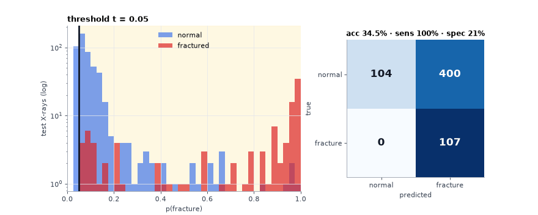

## Headline results (held-out test, n = 611, 107 fractures)

| Metric | Value | 95 % CI (bootstrap) |
|---|---|---|
| **Accuracy** | **93.3 %** | 91.2 – 95.1 % |
| AUROC | 0.940 | 0.912 – 0.963 |
| Sensitivity (recall) | 77.6 % | 69.3 – 85.2 % |
| Specificity | 96.6 % | 95.0 – 98.1 % |
| Precision (PPV) / NPV | 83.0 % / 95.3 % | |
| F1 | 0.802 | 0.739 – 0.859 |
| Majority-class baseline ("always normal") | 82.5 % | |

Confusion matrix: TP 83 · FP 17 · FN 24 · TN 487. The threshold (0.40) was chosen on the validation set only. Accuracy is the same at 0.5.

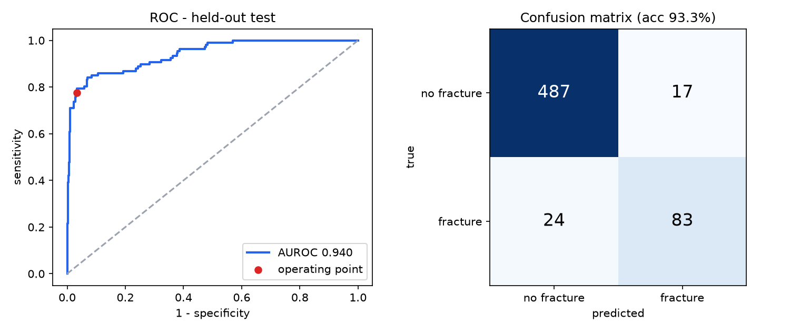

### Where the network looks (Grad-CAM vs. radiologist boxes)

| Localisation check (107 test fractures) | Value |
|---|---|
| CAM peak inside a fracture box | 33.6 % |
| CAM peak inside box enlarged by 50 % | 53.3 % |
| Share of CAM energy inside the box | 5.8 % (boxes cover only 0.8 % of the image, so 7.0× above chance) |

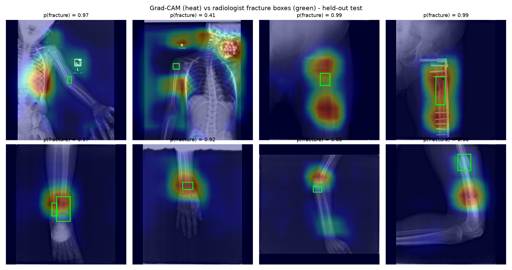

### Spot-check: 10 random held-out X-rays

5 fractured and 5 normal test images, drawn at random (seed 7) and run through the deployed model (`scripts/validate_10_images.py`). **9 / 10 correct.** All 5 normals were cleared (p ≤ 0.14), and 4 of 5 fractures were flagged. In each flagged case the model's Grad-CAM region overlaps the radiologist's box. The one miss is a small toe fracture in a whole-foot view (p = 0.13), which is the kind of subtle case behind the 77.6 % sensitivity.

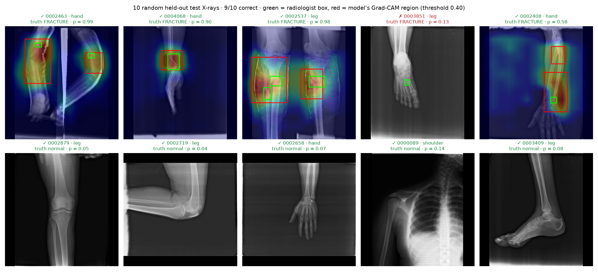

### Subgroups (test)

| Subgroup | n | Accuracy | Sensitivity | Specificity |
|---|---|---|---|---|
| Hand | 229 | 88.2 % | 79.7 % | 91.5 % |
| Leg | 340 | 96.2 % | 74.4 % | 99.0 % |
| Hip | 27 | 96.3 % | 66.7 % | 100 % |
| Shoulder | 15 | 100 % | 100 % | 100 % |
| Frontal view | 384 | 93.8 % | 78.3 % | 97.1 % |
| Lateral view | 219 | 91.3 % | 83.0 % | 93.6 % |
| Oblique view | 52 | 94.2 % | 40.0 % | 100 % |
| No orthopaedic hardware | 595 | 93.3 % | 74.7 % | 96.6 % |

## Visual tour

Fifteen figures plus two animations. Every model result is on the held-out test set.

| | |
|---|---|
| 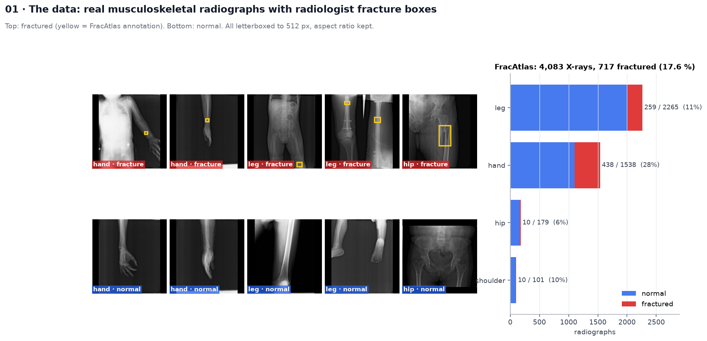 **The data:** FracAtlas X-rays with radiologist boxes | 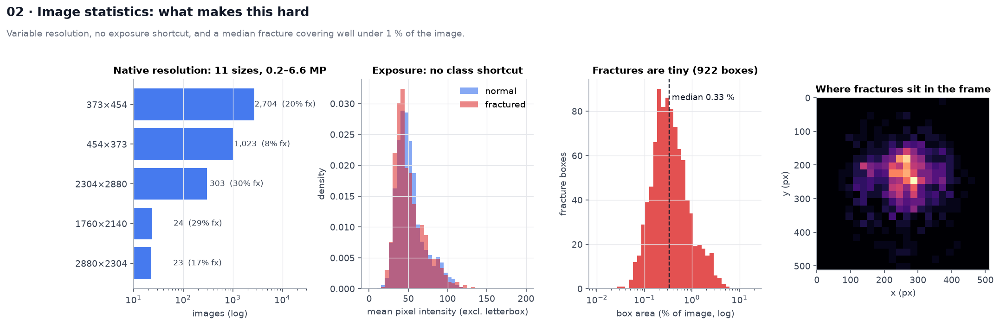 **What makes it hard:** resolution, exposure, tiny fractures |
| 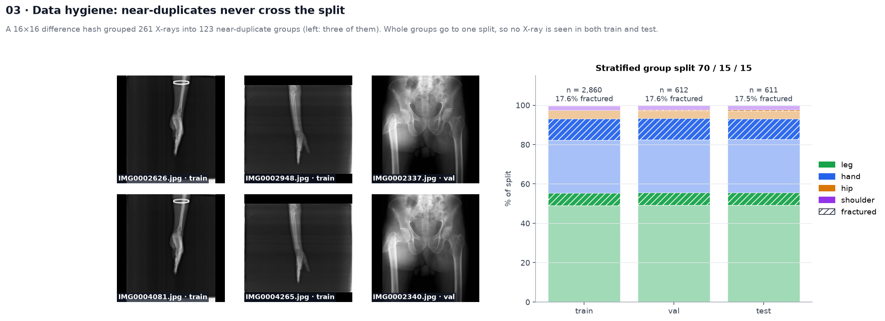 **Near-duplicate groups** never cross the split | 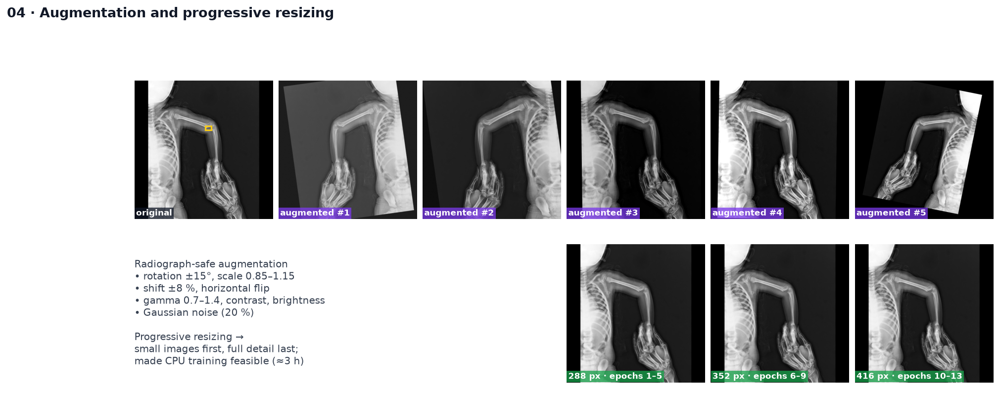 **Augmentation** and progressive resizing |
| 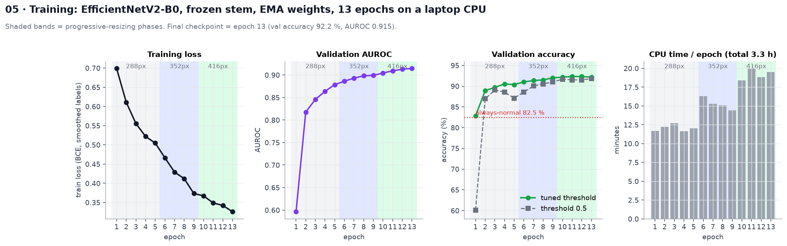 **Training** on a laptop CPU, phase by phase | 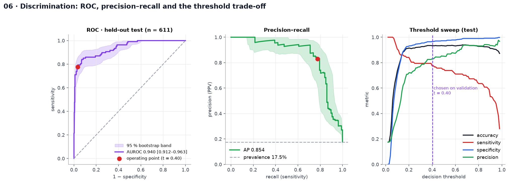 **ROC and PR** with bootstrap bands, threshold sweep |
| 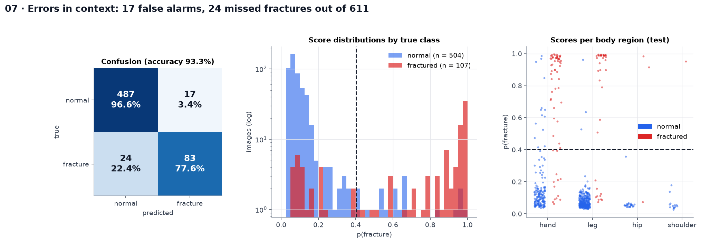 **Errors in context:** score distributions per region | 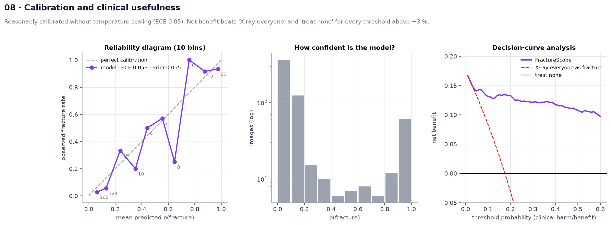 **Calibration** and decision-curve analysis |
| 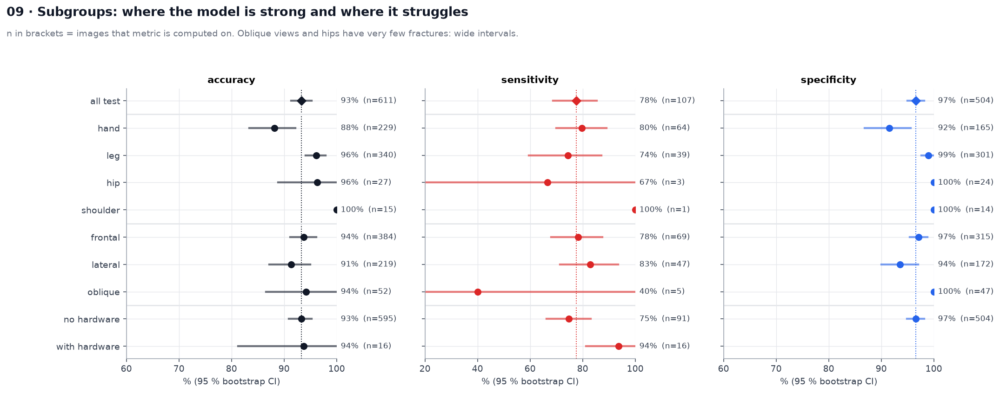 **Subgroup forest plot** with 95 % CIs | 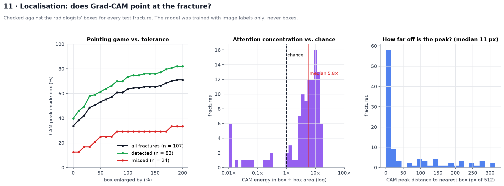 **Does Grad-CAM point at the fracture?** |
| 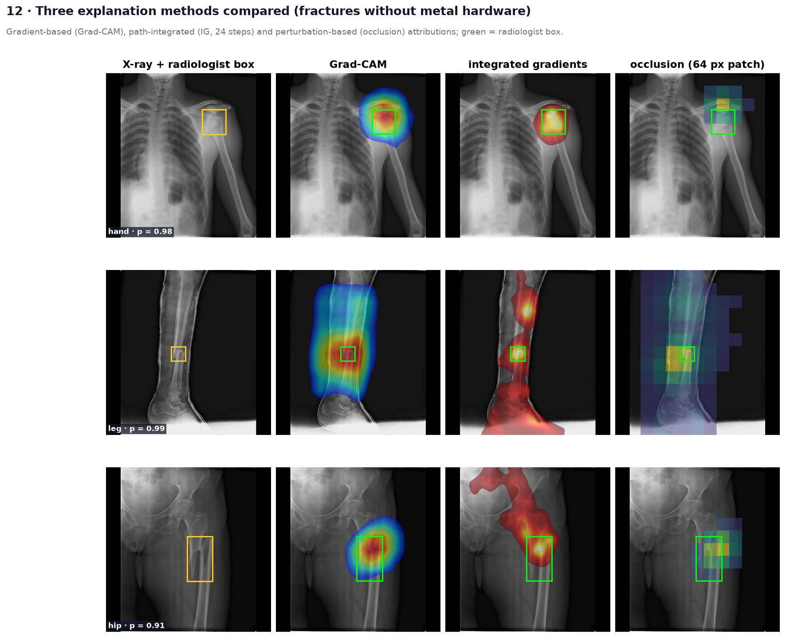 **Grad-CAM vs. integrated gradients vs. occlusion** | 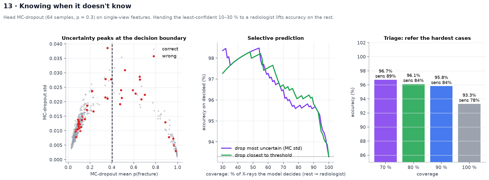 **MC-dropout uncertainty** and selective triage |
| 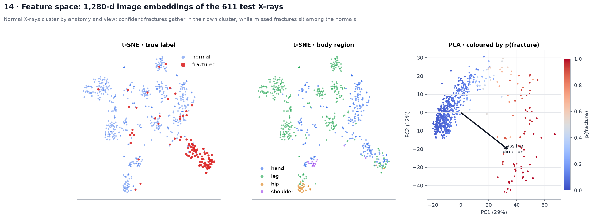 **Feature space:** t-SNE and PCA of the embeddings | 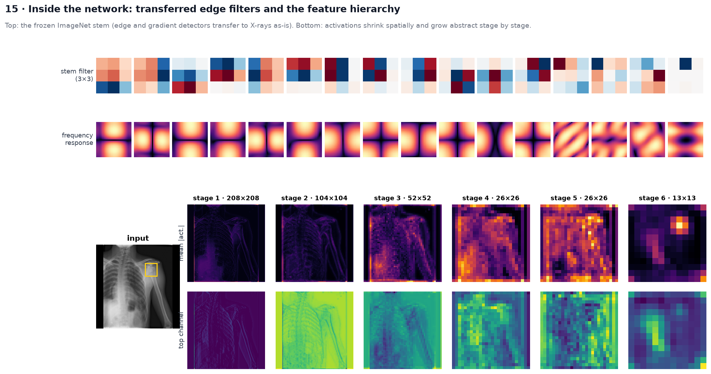 **Inside the network:** stem filters and feature maps |

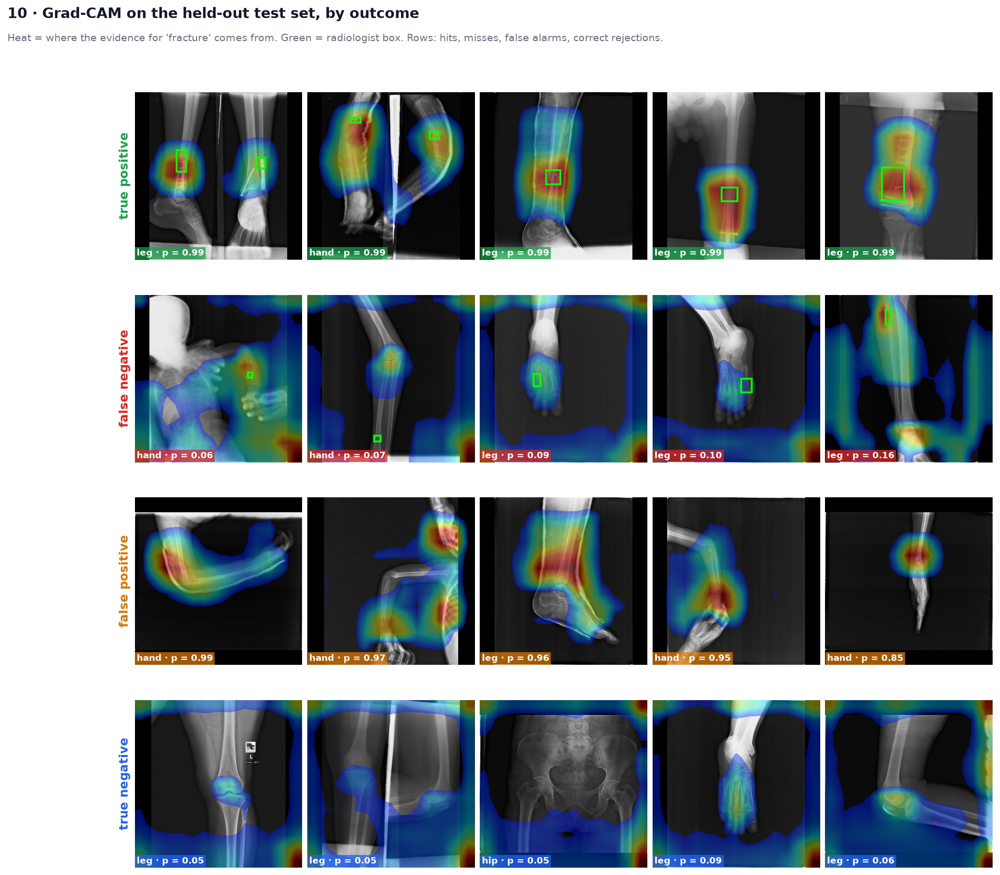
**Grad-CAM by outcome:** hits, misses, false alarms and correct rejections on the test set.

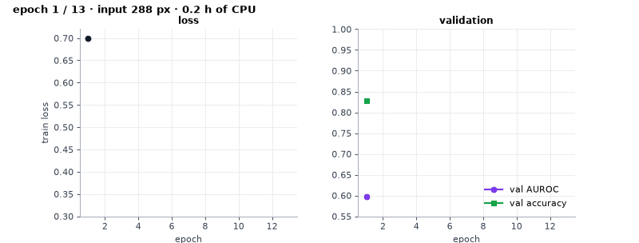

## Method

1. **Data hygiene.**
   - Every radiograph is letterboxed to 512 px with its aspect ratio kept.
   - A 16×16 difference hash finds **154 near-duplicate pairs**. They are grouped, so the same X-ray never lands in both train and test.
   - Split: stratified (fracture × body region) **group** split, 70 / 15 / 15. Train 2,860 / val 612 / test 611, each 17.5 % fractured.
2. **Transfer learning.**
   - `tf_efficientnetv2_b0` (ImageNet), with a new dropout + linear head.
   - The stem and first two stages are frozen; the rest is fine-tuned with AdamW (head LR ×5), cosine schedule, EMA weights (0.998), √-balanced positive weight and light label smoothing.
3. **Progressive resizing.** 288 px (5 epochs) → 352 px (4) → 416 px (4). This made training feasible on a 2-core laptop CPU (≈3 h).
4. **Radiograph-safe augmentation.** Rotation ±15°, scale 0.85–1.15, shift ±8 %, horizontal flip, gamma, contrast/brightness, noise.
5. **Inference.** Horizontal-flip test-time augmentation, validation-chosen threshold, and Grad-CAM on the last conv layer (gradients via `autograd.grad`).

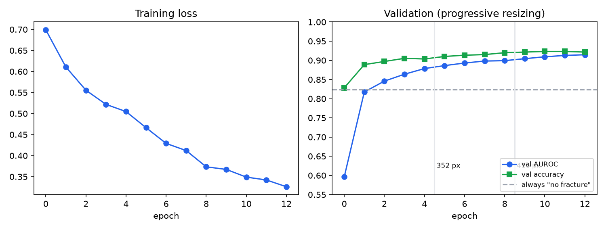

## Honest notes

- **Why not 99 %?** The widely used Kaggle "Bone Fracture Multi-Region" set reaches ~99 %, but its 8,863 images come from about **178 source X-rays** copied by rotation (`10-rotated1-rotated2.jpg`…). Random splits put copies of the same image in train and test, so I did not use it.
- **Sensitivity is the weak point.** The model misses about 1 in 5 fractures (77.6 %), mostly small hairline fractures and oblique views (40 %, only 5 fractures). As a triage aid it is better at ruling out (NPV 95 %) than at ruling in.
- **Shortcut risk.** 97 of the 99 images with plates or screws are fractured. In the test set, hardware cases are easy (sensitivity 93.8 %), so all headline numbers are also reported without hardware (93.3 % accuracy).
- **Localisation is approximate.** Grad-CAM peaks fall inside the box for about 1 in 3 fractures, and within an enlarged box for about half. A box-supervised detector would be the next step.
- Single dataset, single centre, no external validation. Research prototype, **not a medical device**.

## Source code

This public repository is a showcase (write-up, figures, metrics). The full source, trained model and FractureScope app are in a private repository. Access is available on request via GitHub (Engr-HusainNaqvi) or LinkedIn.

Project page: https://engr-husainnaqvi.github.io/Fracture-AI/

## Data & licence

FracAtlas: Abedeen et al., *Scientific Data* 10, 521 (2023), doi:10.1038/s41597-023-02432-4, CC BY 4.0. The images are not redistributed, apart from six example radiographs in `app/examples` (CC BY 4.0, with attribution).
Code, model, figures and text © 2026 Husain Naqvi, All Rights Reserved (see LICENSE).
